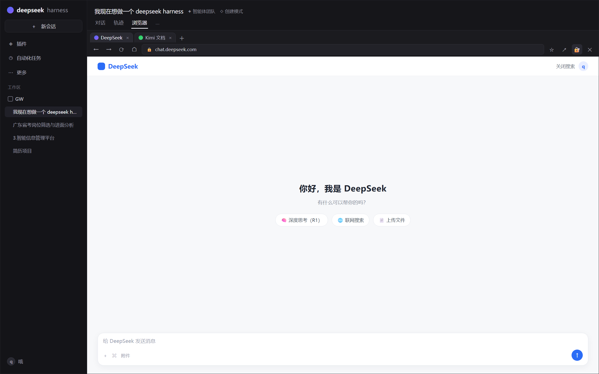
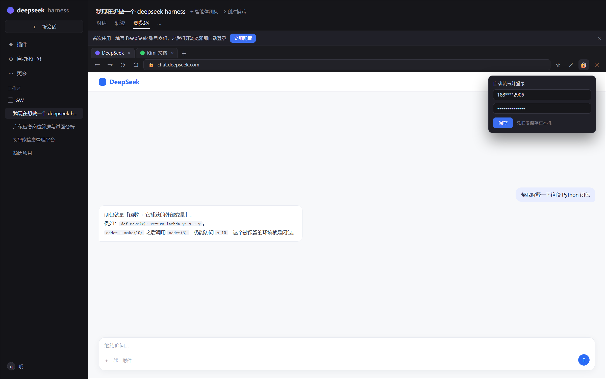

# DSH 浏览器视图插件（dsh-web-browser）

给 [DeepSeek Harness](https://github.com/deepseek-ai/deepseek-harness) 的会话界面加一个「浏览器」标签页：紧挨着「对话」「轨迹」，在标签行下方的视图区域里直接浏览网页。

> 仓库：[GitHub](https://github.com/2054315480/dsh-web-browser) · [Gitee](https://gitee.com/qiuhee/dsh-web-browser)（国内镜像）

> 纯客户端插件，**无需构建**：`client.js` 由 DSH 的客户端模块加载器直接加载。

## 界面预览

| 浏览器视图 | 多标签 + 自动登录 |
| --- | --- |
|  |  |

> 图片为界面样式预览，实际以安装版本为准。

## 使用场景：顺手问个问题，不必切浏览器

在用 DeepSeek Harness 干活时，常有一些「顺口问一句」的小问题——查个报错、翻译一段文档、问问某个 API 怎么写。

以前要么切到浏览器，要么先配置 API Key 才能在 DSH 里问答。

现在可以直接在会话头的「浏览器」里打开 [DeepSeek 网页版](https://chat.deepseek.com/)（插件可自动登录），把它当成随手可用的问答窗口：

- **不用配置 API / Key**：网页账号登录即可用，不消耗 API 配额
- **不用切换窗口**：就在当前 DSH 窗口里，左边是你的会话，右边就是网页
- **小问题更快**：随手一问，不必开新会话、不必等 DSH 的长回复
- **要正经做事时**：切回「对话」标签，继续用 DSH 的完整能力

## 功能

- **「浏览器」标签**：注册 `conversation.view`，与「对话」「轨迹」并排；点击即切换，点「对话」标签或工具栏 ✕ 返回聊天
- **占满视图区**：浏览器激活时自动隐藏聊天输入框，整块区域显示网页；切回对话时自动恢复
- **真实网页引擎**：桌面端使用 Electron `<webview>`（与 DSH 官方侧栏浏览器相同的租约/分区机制），纯 Web 端回退沙箱 iframe
- **完整工具栏**：后退 / 前进 / 刷新 / 主页 / 地址栏（裸域名补 `https://`、纯文字转搜索、`localhost` 走 `http://`）/ 设为主页 / 在系统浏览器打开 / 关闭
- **多标签页**：可同时打开多个标签，标签间切换保留各自地址；`+` 新建标签，标签上的 × 关闭
- **自动登录（可选）**：打开 DeepSeek 时自动切换到密码登录、填写并提交；账号密码只保存在本机
- **环境提示自动关闭**：对 DeepSeek 的「使用环境异常」弹层设置普通 Chrome UA 规避，并用 MutationObserver 兜底自动关闭
- **首次使用引导**：未配置时浏览器内会显示提示条，点「立即配置」即可填写账号密码
- **中英双语**、无障碍（所有按钮带 `aria-label` / `title`）、跟随主题令牌

## 快速开始（小白 3 步）

> **前提**：已安装 **DeepSeek Harness 桌面版**（自带插件管理器和 webview 能力）。纯 Web 版也能用，但网页会退化为 iframe 嵌入，部分站点（如 Google）可能无法显示。

**第 1 步**：打开 DeepSeek Harness，点击左侧边栏的「**插件**」

**第 2 步**：点击「**添加插件**」→ 选择「**安装第三方插件**」

**第 3 步**：在「**包名或地址**」输入框里填入下面任意一个地址，然后安装：

| 情况 | 填入 |
| --- | --- |
| 能正常访问 GitHub | `github:2054315480/dsh-web-browser` |
| 访问 GitHub 慢或失败（推荐国内用户） | `git+https://gitee.com/qiuhee/dsh-web-browser.git` |
| 已经下载了源码到本地 | 源码目录的绝对路径，例如 `D:\plugins\dsh-web-browser` |

安装完成后：

- 插件列表中出现 **dsh-web-browser**（显示名称「浏览器」），确认它处于**已启用**状态
- 如果提示「请重启 DSH 使更改生效」，**退出并重新打开 DeepSeek Harness**
- 否则刷新页面即可

看到会话头出现「浏览器」标签就说明装好了。

## 首次使用

1. 打开任意会话 → 点「浏览器」标签
2. 首次使用会在页面顶部看到提示条「**首次使用：填写 DeepSeek 账号密码，之后打开浏览器即自动登录**」
3. 点「**立即配置**」，填入手机号/邮箱与密码，点「保存」（凭据只保存在本机）
4. 之后每次打开浏览器都会自动登录 DeepSeek；也可以随时点工具栏右侧的**锁图标**修改或关闭自动登录

## 使用说明

| 操作 | 位置 |
| --- | --- |
| 打开浏览器 | 会话头「对话 / 轨迹」旁的「浏览器」标签 |
| 返回聊天 | 点「对话」标签，或工具栏最右的 ✕ |
| 新建标签 | 标签栏右侧的 ＋ |
| 关闭标签 | 标签上的 × |
| 配置自动登录 | 工具栏锁图标 |
| 在系统浏览器打开当前页 | 工具栏 ↗ 图标 |
| 把当前页设为主页 | 工具栏 ⭐ 图标 |

> 多标签共用一个网页引擎：登录状态、Cookie 在标签间共享；切换标签会重新加载该标签的页面地址。

## 自动登录

配置好账号密码后，打开浏览器会：

1. 等待登录页渲染
2. 若显示验证码登录，自动点击「密码登录」
3. 填写账号密码并提交
4. 若出现人机验证 / 短信验证，脚本会停在表单（账号密码已填好），手动完成即可

> **仓库不含任何凭据。** 请勿在 issue / PR 中粘贴账号密码。

## 安全说明

- 自动化脚本通过 `<webview>.executeJavaScript` 在页面自身上下文执行，凭据不会发送给第三方
- 账号密码以明文保存在本机 LocalStorage（键：`dsh-web-browser:login`）；如不需要，请关闭自动登录或留空
- webview 使用 DSH 桌面壳分配的隔离分区（cookie 与其他站点隔离）；应用重启后分区重置

## 常见问题

**安装后没有「浏览器」标签？**
- 确认插件已启用，并**重启** DeepSeek Harness（安装后需要重新加载客户端模块）
- 打开任意会话（空白新会话也会显示标签）

**浏览器区域一片空白？**
- 桌面版才有 webview 引擎；纯 Web 版会退化为 iframe，部分站点禁止嵌入
- 工具栏 ↗ 可以在系统浏览器中打开该页

**「使用环境异常」弹窗还在？**
- 插件会自动关闭它；如果仍然出现，请刷新页面后再试，或在 issue 中反馈

**自动登录没生效？**
- 确认锁图标面板里已保存账号密码
- 若账号开启了短信/人机验证，需要手动完成一次

## 手动安装（开发者）

以本地链接方式安装到某个 profile：

```jsonc
// ~/.dsh/profiles/<profile>/package.json
{
  "dependencies": {
    "@local/dsh-web-browser": "link:/path/to/dsh-browser-plugin"
  }
}
```

或在 profile 的 `cordis.patch.yml` 中注入 Loader 行：

```yaml
- insert:
    - id: web-browser
      name: '@local/dsh-web-browser'
```

安装后刷新页面（或重启应用）。

## 开发

无构建步骤：

| 文件 | 作用 |
| --- | --- |
| `client.js` | 唯一的客户端模块（`window.__ModuleLoader__.load` 包装），注册会话视图、工具栏、自动登录 |
| `index.js` | Host 端空实现（Loader 行需要） |
| `cordis.patch.yml` | 向 bundle 注入 Loader 行 |
| `locale/*.json` | 插件管理器中显示的名称与描述 |

调试：客户端诊断信息写入 LocalStorage 键 `dsh-web-browser:diag`（包含 guest 启动、租约、自动登录、弹层关闭等阶段）。

## English

A DeepSeek Harness client plugin adding a **Browser** conversation view next to Chat/Trajectory. Render pages in an Electron `<webview>` guest on desktop (iframe fallback on plain web), hide the chat composer while active, support multiple tabs, auto-dismiss DeepSeek's environment banner, and optionally auto-fill the DeepSeek password login (credentials stay in local LocalStorage — never in this repository).

**Install**: open the *Plugins* page in DSH → **Add plugin** → **Install third-party plugin** → paste `github:2054315480/dsh-web-browser` (or the Gitee URL) → install → restart DSH.

**Why**: browse the web beside your DSH session — and ask DeepSeek quick questions via the web UI without configuring an API key or switching windows.

## License

MIT
